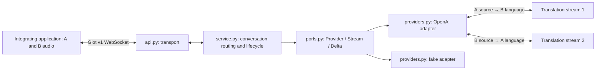

# Conversation API — interview v1

## Product intent and scope

Glot's public site centres on people understanding each other, with experiences for a shared phone, multiple phones and remote calls. My interpretation: the reusable platform primitive is a **conversation between people**, with translation as a capability inside it. A transcription endpoint alone would leave every product rebuilding direction, attribution and lifecycle.

Build one complete slice: two participants, each with an isolated microphone stream and a preferred language; each receives the other's translated text and audio. One integrating application multiplexes both participants over one WebSocket. This could be a server integrating an existing call. It is not yet a room people join independently.

Assumptions: participants usually speak their declared language; clients supply labelled audio and handle playback; language pair stays fixed for a conversation. The upstream detects source speech language. Identity labels are trusted input in this local exercise, not authenticated identities. Follow the brief's unlimited-provider assumption: no upstream quotas, billing or capacity planning.

## Architecture



These are modules in one process, not microservices. `api.py` owns JSON transport, provider selection and the connection deadline. `service.py` owns participant routing, input validation and session lifetime. `ports.py` defines the small application-owned streaming contract. `providers.py` translates that contract to vendor messages. Dependencies point from adapters toward application contracts; the service imports no vendor or web framework.

The abstraction is a **directional translation stream**: `open(target)`, `send(audio)`, `finish()`, `events()`. It preserves simultaneous input and output rather than pretending a streaming model is a request/response function. Provider events become three application delta types; provider session IDs and event names never reach callers. PCM16 mono at 24 kHz is an explicit v1 platform media contract. Another vendor must satisfy it, possibly through conversion in its adapter. Provider independence does not imply every provider has equal language or media capabilities.

## API and lifecycle

Connect to `/v1/conversations`. First message:

```json
{"type":"start","participants":{"alice":"en","bob":"es"}}
```

Wait for `{"type":"ready"}` after both upstream streams are configured. Then send:

```json
{"type":"audio","speaker":"alice","data":"<base64 PCM16>"}
```

The server streams `audio.delta`, `translation.delta` and `source.delta`, each with `speaker`, `recipient`, and `data`. Translation and audio go to the other participant; source transcript goes to the speaker. Text deltas are append-only fragments, not final sentences. Order is preserved per stream; independent directions have no global speech ordering. The integrating client forwards events by recipient and must prevent translated playback feeding back into microphones.

`{"type":"end"}` ends input for both speakers. The service finishes both upstream streams and drains their remaining output before sending `{"type":"ended"}` and closing. Disconnect, invalid input, timeout or provider failure aborts the conversation and releases both provider contexts. Errors close with 1011 and a generic reason in this skeleton; structured validation and operational error codes are an early API improvement. Clients start a new conversation after failure; there is no replay or resume guarantee.

The OpenAI adapter follows the supplied translation guide: dedicated translation endpoint, target-language configuration, continuous audio append, delta output, and explicit finish/drain. It is not a voice-agent conversation loop. It waits for creation and configuration acknowledgement before readiness.

## Decisions and trade-offs

| Decision | Benefit | Cost / boundary |
|---|---|---|
| Two directional streams | Clear speaker ownership and simultaneous speech | Two provider sessions; no cross-speaker model context |
| One application socket | Small complete integration surface | No independent participant join, leave or reconnect |
| Application-owned events | Provider swaps do not change callers | Adapter must translate semantics; capability negotiation deferred |
| Await sends and bounded provider buffers | Avoid an unbounded application audio backlog | One slow receiver can stall both directions; five-minute deadline bounds the demo |
| Ephemeral state in one worker | Easy to run and reason about | Worker loss ends calls; no history or horizontal room coordination |

Do not silently retry live speech: replay may duplicate words, and a fresh provider stream may lose context. Explicit failure is preferable until continuity semantics are designed. Never log audio/transcripts by default. This repository has no persistence or application content logging; upstream retention is a separate deployment policy.

## What I deliberately did not build

No frontend, microphone capture, codec negotiation, automatic speaker separation, WebRTC/SIP stack, recording, distributed room service, billing or plugin framework. These do not establish the proposed module boundaries. A shared microphone needs speaker/language separation that this v1 does not claim to solve. Authentication and tenant authorization are omitted for a localhost demonstration and are required before external exposure. The fake provider proves plumbing only; real translation quality is not demonstrated by it.

## What expands next

1. **Separate participant connections:** add conversation creation, short-lived participant grants and a connection registry around the service. Derive speaker identity from the grant, rather than trusting message labels. Add tenant authorization, language validation and admission limits. This turns the integration primitive into two-device conversations without changing provider adapters.
2. **One-to-many captions:** generalise the route map to subscriptions. Open a stream per source and distinct requested target language, then fan out to listeners sharing that language. Cost grows with sources × distinct target languages, not simply listener count. Add bounded per-listener delivery queues so one slow listener cannot stall everyone. This enables meetings and broadcasts; interactive multiparty speech also needs playback policy.
3. **Telephony / browser media:** add an ingress adapter for SIP/Twilio or a WebRTC media worker, converting media to the v1 PCM contract and using the same service/provider port. This expands transport reach; it does not require putting telephony concepts in the translation abstraction.

Before a customer pilot: measure time to first translated output, input/output lag, disconnect and drain failures; evaluate comprehension and translation quality with bilingual listeners across accents and interruptions. Establish a latency baseline before promising an SLO. Add slow-client deadlines and structured errors. Test provider compatibility against fixtures and a real short bilingual audio sample. These are readiness work, not extra product modes.

## Sources and limits

- [Glot public site](https://www.glot.com/) — glot.ai redirected here when reviewed on 31 October 2026. Public positioning informs the interpretation above; the exercise's all-use-cases ambition is the design requirement. Public product constraints need not become permanent platform constraints.
- [OpenAI realtime translation guide](https://developers.openai.com/api/docs/guides/realtime-translation) — protocol reference, reviewed on the same date. The real adapter is implemented and fixture-tested; no live credentialed translation was run.
